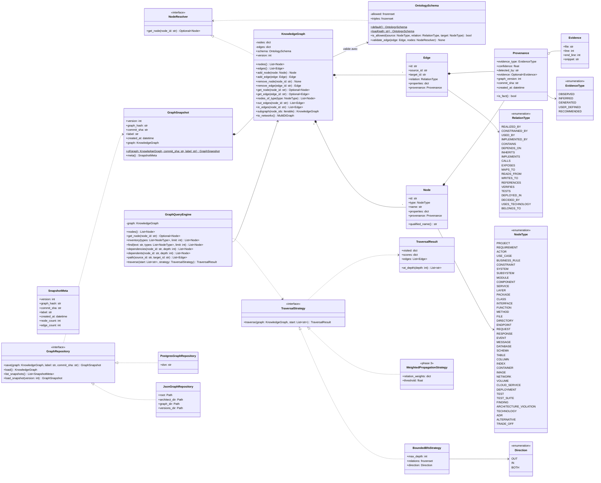
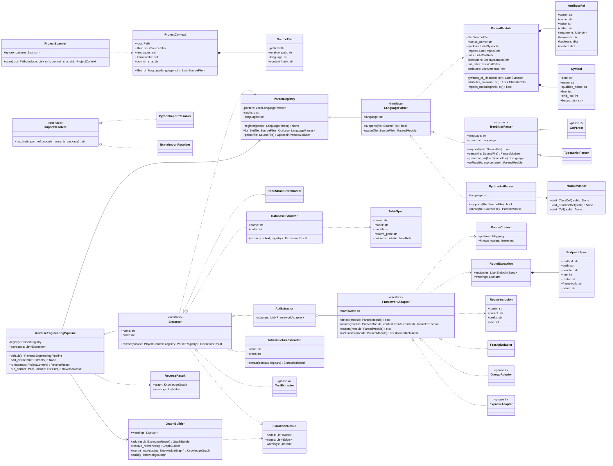
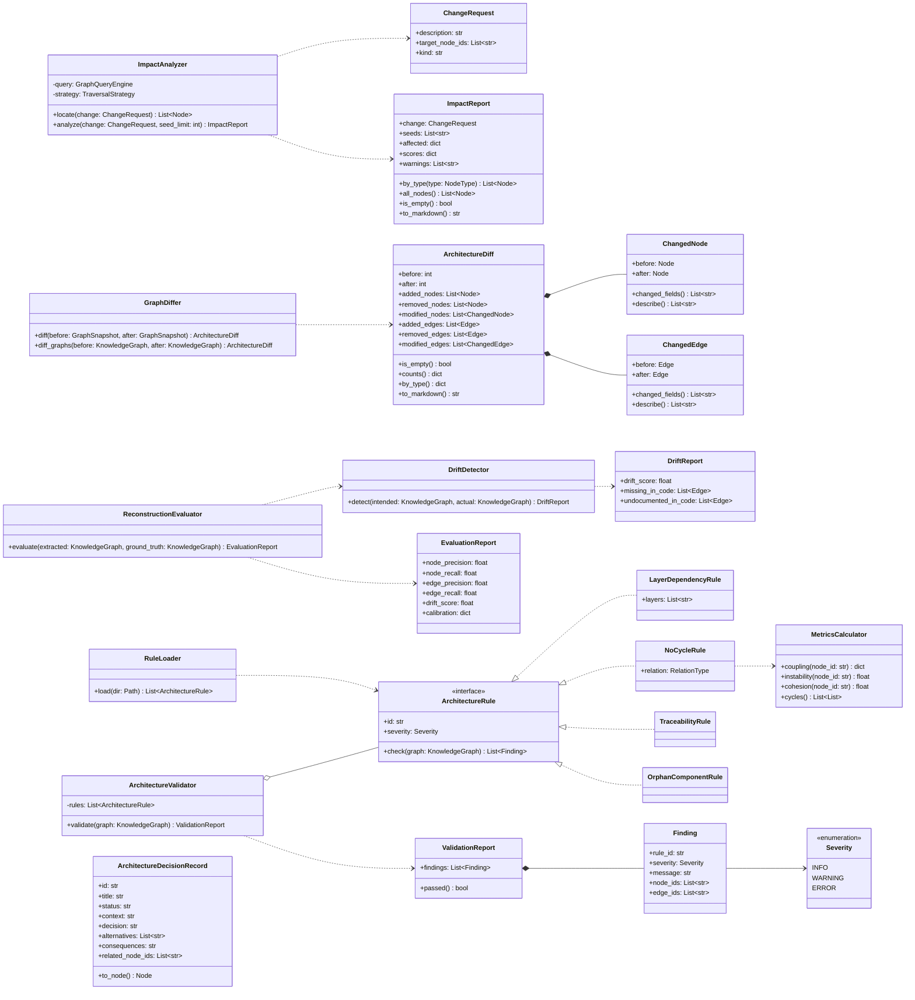
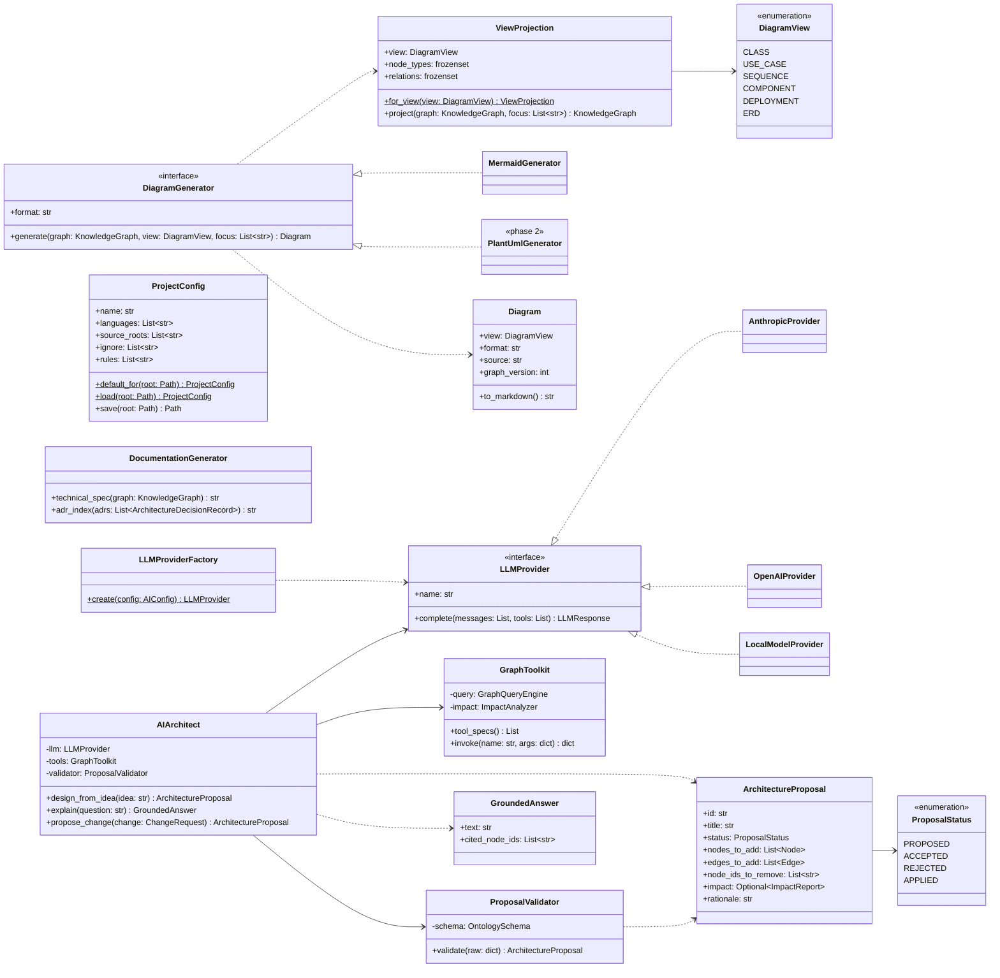
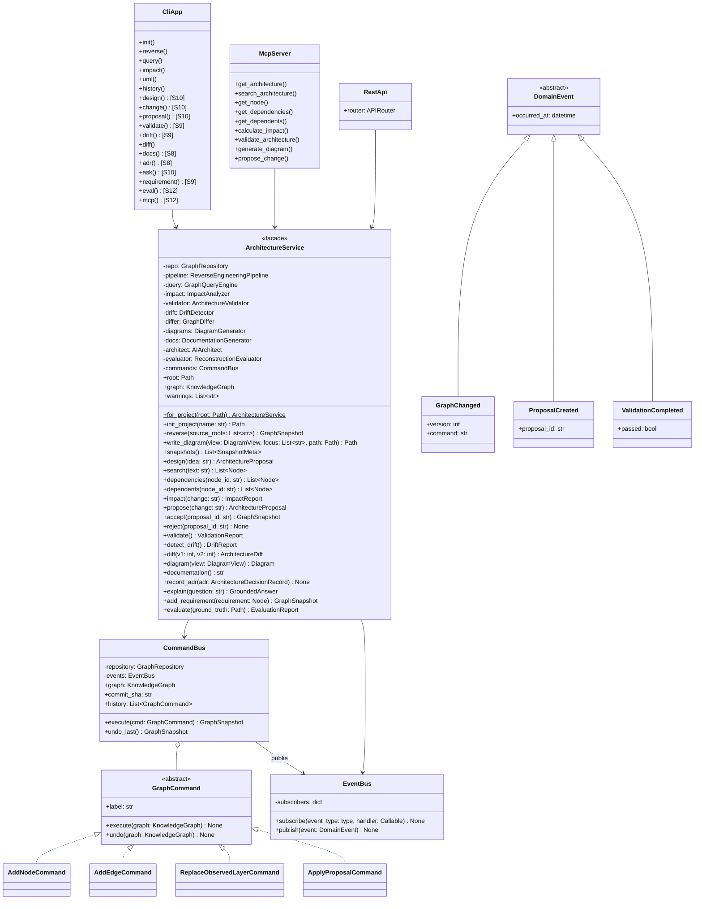

# Diagrammes de classes — SAKG

Format : Mermaid (`classDiagram`), lisible par Claude Code, Cursor, GitHub et VS Code.
Le modèle est découpé par module pour rester lisible. Les noms correspondent aux
modules Python cibles (`src/sakg/<module>/`).

Légende : `<<interface>>` = classe abstraite / Protocol · `<<enumeration>>` = Enum ·
`*--` composition · `o--` agrégation · `..|>` réalisation · `<|--` héritage · `..>` dépendance

---

## 1. Cœur : domaine et Knowledge Graph (`domain/`, `graph/`)

`NodeResolver` est défini dans `domain/` pour que `OntologySchema` valide une relation sans
importer `graph/` ; `KnowledgeGraph` l'implémente structurellement (`Protocol`).

---

## 2. Reverse engineering (`reverse/`)

Le reverse parse Python via `PythonAstParser` (`ast`, [ADR-003](../adr/ADR-003-parser-python.md))
et TypeScript via `TypeScriptParser` (Tree-sitter). Un langage supplémentaire s'ajoute par un
`LanguageParser` enregistré et, si besoin, un `ImportResolver`. `GoParser` reste prévu.

---

## 3. Analyse, validation et évolution (`analysis/`, `validation/`)

---

## 4. Génération et IA (`generation/`, `ai/`)

---

## 5. Application et interfaces (`application/`, `interfaces/`)

