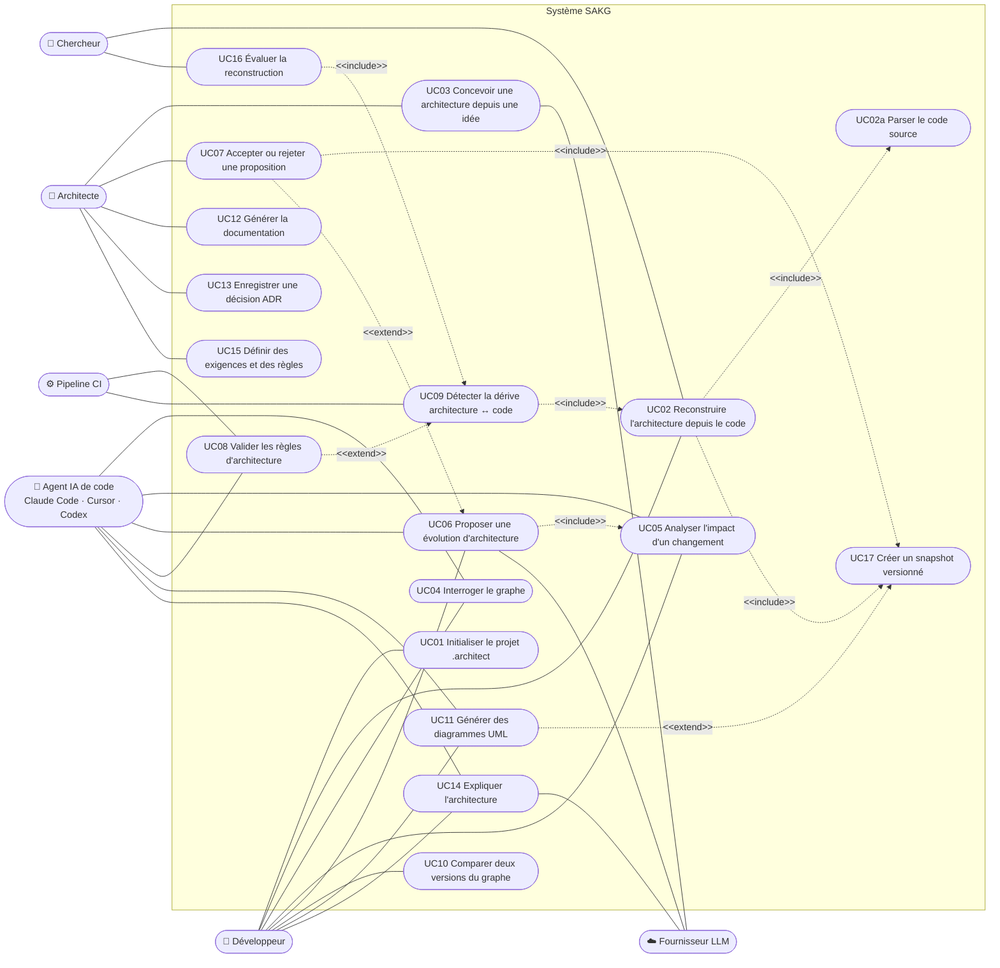

# Cas d'utilisation — SAKG

Mermaid n'a pas de type natif « use case » : le diagramme utilise un `flowchart` avec la
convention suivante — acteurs à gauche/droite, cas d'utilisation en forme de stade dans le
cadre du système, `<<include>>` et `<<extend>>` en pointillés.

## 1. Acteurs

| Acteur | Type | Description |
|---|---|---|
| Développeur | principal | utilise la CLI ou l'IDE pour comprendre et faire évoluer le projet |
| Architecte | principal | définit exigences, règles, ADR ; valide les propositions |
| Agent IA de code | principal | Claude Code, Cursor, Codex — interroge le graphe via MCP |
| Chercheur | principal | évalue la reconstruction et la dérive sur des jeux de données |
| Pipeline CI | principal | exécute la validation à chaque commit |
| Fournisseur LLM | secondaire | Anthropic, OpenAI, modèle local — sollicité par le système |

## 2. Diagramme

> Lecture des `<<extend>>` : la flèche part du cas qui étend vers le cas de base.
> Ex. UC07 (accepter) étend UC06 (proposer) ; UC11 (régénérer les diagrammes) peut
> s'exécuter après UC17 (nouveau snapshot).

## 3. Fiches des cas d'utilisation

| ID | Nom | Acteur(s) | Entrée | Résultat | Commande / outil |
|---|---|---|---|---|---|
| UC01 | Initialiser le projet | Dév. | racine du projet | dossier `.architect/` + `project.yaml` | `sakg init` |
| UC02 | Reconstruire l'architecture | Dév., Chercheur | code source | graphe OBSERVED/INFERRED + snapshot | `sakg reverse` |
| UC03 | Concevoir depuis une idée | Architecte, LLM | description textuelle | proposition (nœuds GENERATED) | `sakg design` |
| UC04 | Interroger le graphe | Dév., Agent | nom, id, type | nœuds, dépendances, dépendants, chemins | `sakg query` · `get_dependencies` |
| UC05 | Analyser l'impact | Dév., Agent | changement décrit | `ImpactReport` par niveau | `sakg impact` · `calculate_impact` |
| UC06 | Proposer une évolution | Dév., Agent, LLM | changement décrit | `ArchitectureProposal` PROPOSED | `sakg change` · `propose_change` |
| UC07 | Accepter / rejeter | Architecte | id de proposition | graphe mis à jour ou proposition rejetée | `sakg proposal accept/reject` |
| UC08 | Valider les règles | CI, Agent | graphe + règles | `ValidationReport` (code retour ≠ 0 si erreur) | `sakg validate` |
| UC09 | Détecter la dérive | CI | graphe voulu + code | `DriftReport` + score | `sakg drift` |
| UC10 | Comparer deux versions | Dév. | deux versions | `ArchitectureDiff` | `sakg diff v1 v2` |
| UC11 | Générer des diagrammes | Dév., Agent | vue + focus | fichier Mermaid/PlantUML | `sakg uml --view` |
| UC12 | Générer la documentation | Architecte | graphe | spécification Markdown | `sakg docs` |
| UC13 | Enregistrer une ADR | Architecte | décision | ADR reliée aux composants/technologies | `sakg adr new` |
| UC14 | Expliquer l'architecture | Dév., Agent, LLM | question | réponse citant les ids des nœuds | `sakg ask` |
| UC15 | Définir exigences et règles | Architecte | YAML / saisie | nœuds USER_DEFINED, règles actives | `sakg requirement add` · `rules/` |
| UC16 | Évaluer la reconstruction | Chercheur | graphe + vérité terrain | précision, rappel, dérive, calibration | `sakg eval` |
| UC17 | Créer un snapshot | système | graphe courant | version N+1 enregistrée | interne |

## 4. Scénario détaillé — UC06 Proposer une évolution

**Préconditions :** le graphe existe (UC02 ou UC03 déjà exécuté).

1. L'utilisateur (ou l'agent) décrit le changement : « Ajouter les paiements mobiles ».
2. Le système localise les nœuds concernés (recherche lexicale et sémantique).
3. Le système calcule l'impact (UC05).
4. Le système transmet l'impact et les outils de lecture du graphe au fournisseur LLM.
5. Le LLM renvoie une proposition structurée (nœuds, relations, justification).
6. Le système valide la proposition contre l'ontologie.
7. Le système enregistre la proposition au statut PROPOSED et l'affiche.

**Alternatives :**
- 5a. Sortie du LLM invalide → nouvelle tentative (max. 2), sinon erreur explicite.
- 6a. Relation hors ontologie → retirée et signalée dans la proposition.

**Postconditions :** aucune modification du graphe tant que UC07 n'a pas accepté la proposition.
